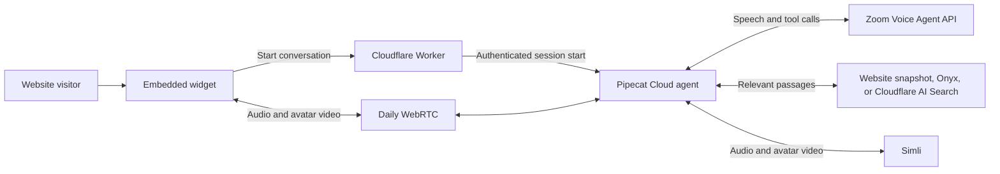

# Nova Website Assistant

Build a voice-and-avatar assistant for a website using the Zoom Voice Agent API, Pipecat and Simli. This repository contains the assistant, its embeddable widget and a Cloudflare Worker. The companion [Alpine Outfitters repository](https://github.com/ChangliangLiu/alpine-outfitters-demo) supplies a ski store with products and guides to experiment with.

The project is a developer-oriented demonstration. Start with the two repositories locally, learn how the APIs fit together, then deploy the assistant and website to your own accounts.



Locally, the widget connects to the Python agent directly over SmallWebRTC; Pipecat Cloud uses Daily. The Zoom Voice Agent API handles speech, conversation and function calls. When a visitor asks about the website, the agent's `search_website` tool provides relevant content to Zoom. Simli turns the response audio into an animated avatar. Provider keys stay on the agent or Worker, not in the page.

## Developer workflow

1. Clone this repository and the [Alpine demo](https://github.com/ChangliangLiu/alpine-outfitters-demo).
2. Read the [setup and deployment guide](docs/INTEGRATION.md), including the architecture and credential sections.
3. Create accounts and credentials for Zoom Voice Agent, Simli, Cloudflare and Pipecat Cloud. Onyx and Cloudflare AI Search are optional; the initial demo uses a local snapshot of the website.
4. Build the website, import its content feed, and run and test both projects locally.
5. Deploy the Python agent to Pipecat Cloud, the widget gateway to Cloudflare Workers, and the website to Cloudflare Pages.

```sh
git clone https://github.com/ChangliangLiu/nova-website-assistant.git
git clone https://github.com/ChangliangLiu/alpine-outfitters-demo.git
```

See the [complete guide](docs/INTEGRATION.md) for the exact commands, the account setup, how to change the website and optional indexed knowledge. [Zoom Voice Agent integration](docs/ZOOM_VOICE_AGENT.md) explains the real-time pipeline; [phone calls](docs/PHONE.md) covers the optional audio-only channel.

## Repository map

- `agent/server.py` builds the Pipecat voice and avatar pipeline and local server.
- `agent/prompts/` holds the spoken conversation instructions.
- `agent/website_search.py` searches the imported website snapshot; `agent/onyx_search.py` and `agent/cloudflare_search.py` support indexed documents and pages.
- `bot.py` runs the agent on Pipecat Cloud; `cloud/worker.mjs` serves the widget and starts sessions.
- `web/` contains the framework-independent widget and iframe. `scripts/import-site.mjs` imports the website's content feed.

## Verify the code

From this repository, after installing the dependencies in the guide:

```sh
node --test tests/*.test.mjs
PYTHONPATH=agent .venv/bin/python -m pytest -q
npm run build
```

The tests use mocks where appropriate. Also test a real microphone conversation, avatar video and a source-based answer in your own environment; provider usage may be billed.

## License

MIT. See [LICENSE](LICENSE).
