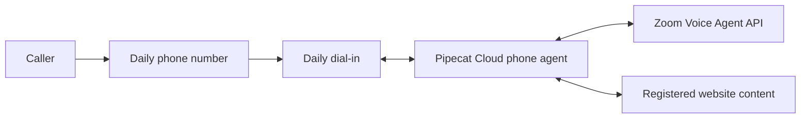

# Add an inbound phone number

Nova can receive ordinary phone calls through Daily PSTN and Pipecat Cloud. Callers hear the same Zoom Voice Agent API and registered website knowledge as the browser assistant. Phone calls are audio-only: they do not start Simli or display source links. Nova can mention source titles aloud. Browser conversations continue to use their existing agent and avatar.



## Prepare the phone agent

1. Register the website as described in the [integration guide](INTEGRATION.md#4-prepare-production-website-content). `Dockerfile.phone` sets `PHONE_SITE_ID=alpine`; change that value to your registered `siteId` for your deployment. The server configuration selects the site, not the caller.
2. Edit `pcc-phone.toml` with your own agent name, region and secret-set name. The secret set must include `ZOOM_AI_API_KEY`; `ZOOM_VOICE` is optional. It may be the same secret set as the browser agent. Simli keys are not used by the phone agent.
3. Log in to Pipecat Cloud, then deploy the separate image:

```sh
pipecat cloud deploy --config-file pcc-phone.toml --dockerfile Dockerfile.phone --build-dir .
pipecat cloud agent deployments YOUR_PHONE_AGENT_NAME
```

The example uses zero warm agents and one concurrent session. A cold start can delay the initial greeting; larger limits may incur greater usage. The agent enforces a ten-minute session timeout. Update and redeploy the phone agent when changing the site registration or its server-side settings. Keep its Onyx document set current.

## Connect a Daily phone number

In the Pipecat Cloud dashboard, open **Phone numbers**. Buy a number for your account, then associate it with your phone agent using the dashboard's call routing configuration. Follow [Pipecat's current Daily dial-in instructions](https://docs.pipecat.ai/pipecat-cloud/guides/telephony/daily-dial-in) for the automatic webhook setup. Confirm the agent is active before calling the number. Numbers have a monthly charge and calls incur usage charges; review [Pipecat Cloud pricing](https://www.daily.co/pricing/pipecat-cloud/) and any Zoom charges before enabling public use.

The agent expects Pipecat Cloud's Daily dial-in request, including its `dialin_settings`, `daily_api_key`, and `daily_api_url`. It accepts only the production Daily API URL and does not use the caller's number for personalization. Provider or transport logs may contain call metadata. Secure access to your Pipecat Cloud organization and session-start credentials; do not expose a cloud API key in the website.

## Show the option in the widget

Only display a number after it is provisioned, routed, and tested. Set Cloudflare Worker variables `PHONE_SITE_ID` and `PHONE_NUMBER` (E.164 format, for example `+14255550100`) for the registered site, then redeploy. Keep existing secrets and variables when deploying. The worker only exposes the number for the matching site. The widget shows a `tel:` link when a valid number is configured; while the browser conversation is active it retains the single **End conversation** control.

## Verify

Call the number from a real phone. Check that Nova greets the caller, hears a product question, answers from the site's documents, and responds to a policy follow-up and an interruption. Hang up and confirm the Pipecat session ends. Also retest a browser conversation and confirm the avatar still works. Check the cloud agent's logs and Daily routing if a call does not connect. A static preview or an active deployment alone is not a successful phone call.

```sh
PYTHONPATH=agent .venv/bin/python -m pytest -q
node --test tests/*.test.mjs
```

Phone callers receive audio only; no browser transcript or clickable citations are available to them. The prototype is not a call center, does not support transfers or emergency services, and has not been load-tested. Review authorization, abuse prevention, privacy notices, provider usage and spending controls for your deployment.
