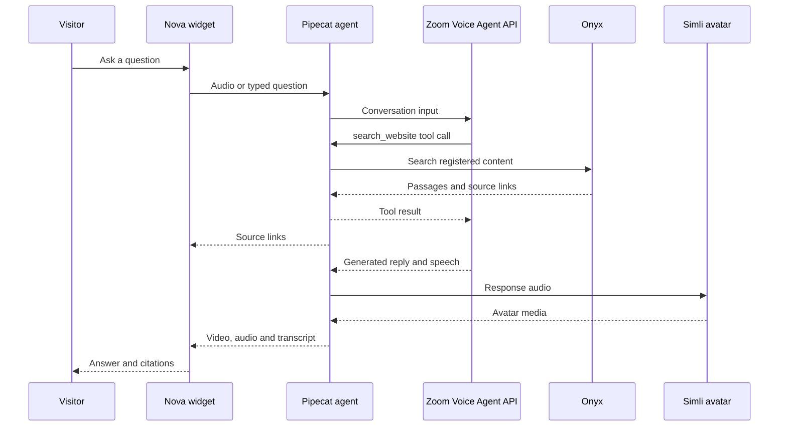

# Building website conversations with the Zoom Voice Agent API

Nova demonstrates how to connect website knowledge to a spoken, visual conversation using the **Zoom Voice Agent API**. Zoom is the conversational core: it processes speech, produces transcripts and spoken replies, and can call application functions. Pipecat connects that voice service to Daily or SmallWebRTC, website search, and a Simli avatar.

Start with [Zoom's Voice Agent overview](https://developers.zoom.us/docs/ai-services/voice-agent/) and the [credential setup in the integration guide](INTEGRATION.md#2-get-your-provider-credentials). The pipeline in this repository is [`agent/server.py`](../agent/server.py).

## Why Zoom Voice Agent is central to Nova

Zoom's API supports a real-time voice session with streaming audio, automatic turn detection, transcripts, synthesized speech, function calls, and barge-in. Nova uses these capabilities to let a website visitor ask about published products, guides and policies. The website owner chooses the content; Zoom's model can request a search and use its results to formulate a reply. The included implementation uses Zoom's Voice Agent integration and its configured output voice, defaulting to `jenna`.

The API is useful beyond the Alpine demo: the same approach can power a documentation guide, product adviser or support assistant. The included application only answers questions and returns sources; it does not place orders, process payments or issue refunds.

## Follow a visitor's question

1. The website loads the Nova widget. When a visitor connects, the browser requests microphone access.
2. For Pipecat Cloud, the Cloudflare Worker starts the configured agent and returns Daily connection details. The browser and agent join the Daily session.
3. The Pipecat pipeline sends incoming audio to `ZoomAIRealtimeLLMService`. Zoom processes the conversation and can call the registered `search_website` function.
4. The search adapter queries the configured Onyx document set. The tool returns relevant passages to Zoom and sends source links to the widget.
5. Zoom generates the reply and audio. Pipecat passes the audio through `SimliVideoService`; the widget receives the avatar media and displays the conversation and sources.

For local evaluation, SmallWebRTC replaces Daily and the Cloudflare Worker. The conversation and retrieval pipeline is shared.



## Configuration and credentials

The agent creates `ZoomAIRealtimeLLMService` with `ZOOM_AI_API_KEY` and website-specific instructions. `ZOOM_VOICE` selects the output voice. Store these on the Python agent only:

```dotenv
ZOOM_AI_API_KEY=your-zoom-ai-services-api-key
ZOOM_VOICE=jenna
```

Create the key in your [Zoom AI Services project](https://zoom.ai/) with access to Voice Agent. Follow [Zoom's credentials guide](https://developers.zoom.us/docs/ai-services/auth/) and [live-session documentation](https://developers.zoom.us/docs/ai-services/voice-agent/live-mode/) for current permissions and protocol details. Never put this key in a widget script, website feed, repository, or browser bundle.

The repository pins the Pipecat source revision that supplies its Zoom integration in [`requirements.txt`](../requirements.txt) and [`requirements-cloud.txt`](../requirements-cloud.txt). The local and cloud requirements must remain compatible when upgrading. Pipecat manages the Zoom connection; Nova's typed-input bridge also calls private Pipecat methods, so verify typed input and conversation behavior when changing the pinned revision.

## Ground answers in website content

[`agent/onyx_search.py`](../agent/onyx_search.py) searches the configured Onyx document set. The `search_website` function in `agent/server.py` returns passages to the model and separately sends citations to the interface. Instructions ask the model to search for factual website questions and say when the supplied content cannot establish an answer.

Good content matters: include current product details, prices, relevant policy exceptions and canonical links. Configure Onyx connectors and indexing to keep website pages and documents current. The assistant cannot verify live inventory or mountain conditions unless an approved source supplies them; assess grounding and source quality for your use case.

## Voice, avatar and testing

The intended experience is a microphone-on conversation after browser permission, a moving avatar, transcripts and a single **End conversation** control. Zoom documents automatic turn detection and interruption support, but actual interruption and media behavior must be tested with your Pipecat version, providers, browser and deployment; library capability alone does not establish end-to-end parity.

After configuring Zoom and Simli, follow the [integration guide](INTEGRATION.md) to run locally or deploy to Pipecat Cloud. Test a spoken product question, an exception in a policy, a question the indexed documents cannot answer, an interruption, and the end-conversation control. Check the displayed source links against the published site. Keep provider logs and transcripts appropriately protected.
